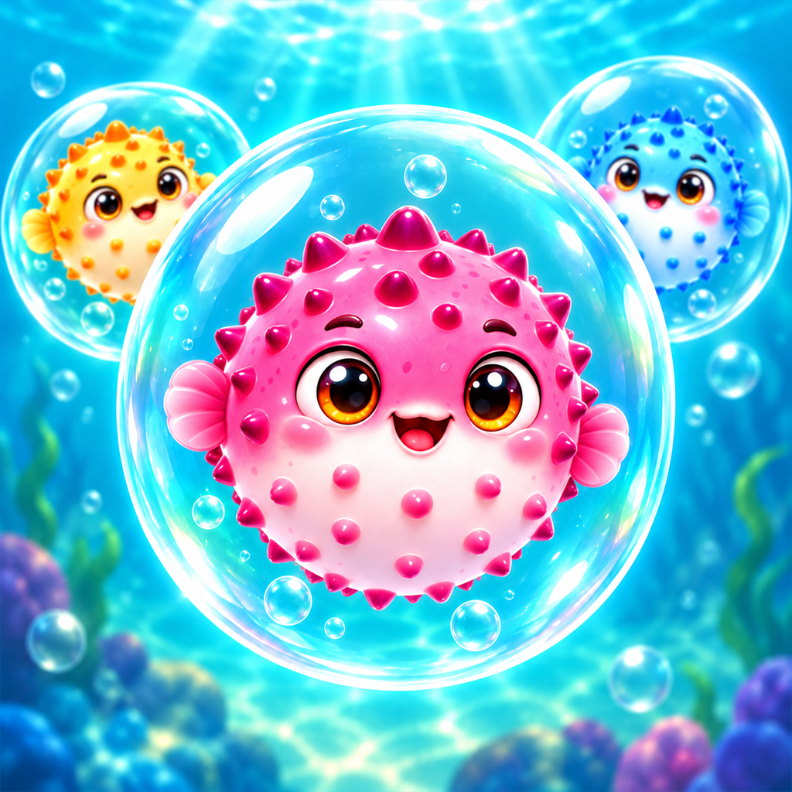
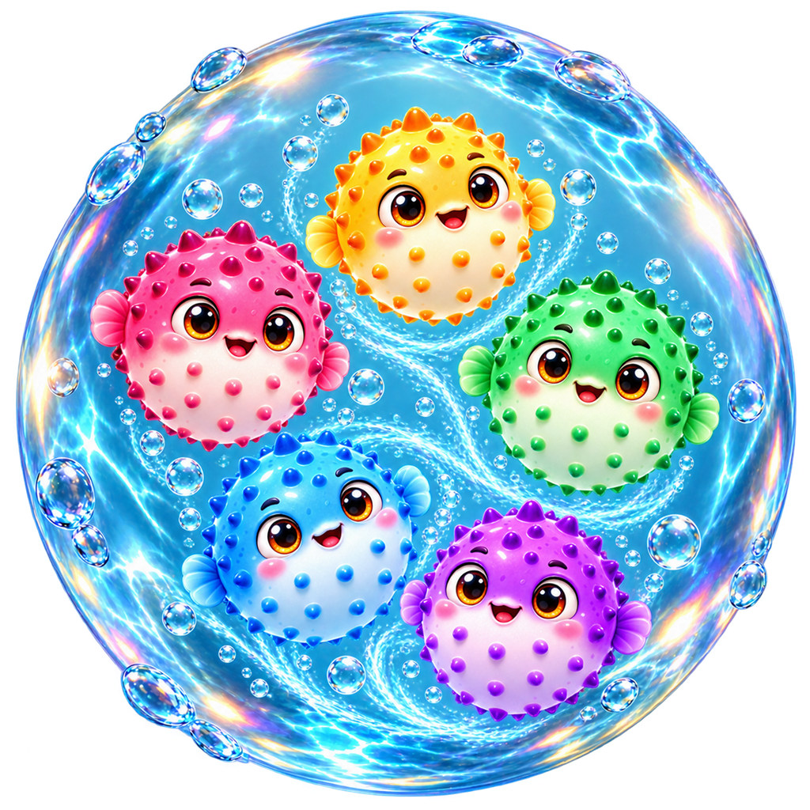

# Bubblefin Pop

<p align="center">
  
</p>

<p align="center">
  A polished portrait puzzle game about dropping water bubbles, merging matching pufferfish, and freeing complete schools.
</p>

<p align="center">
  <strong>React Native · Expo · TypeScript · iOS & Android</strong>
</p>

## Overview

Bubblefin Pop is a mobile physics-puzzle game developed under the Görsen Games label. Players drag a bubble across the launcher, release it into a water-filled arena, and create same-color chains. Completed bubbles burst while their pufferfish swim toward the rescue counter.

The project focuses on tactile interaction, readable color sorting, stable custom physics, fluid animation, and short mobile-friendly levels. It contains 100 levels across five themed worlds, including three guided onboarding stages.

<p align="center">
  
</p>

## Highlights

- Touch-anywhere launcher with direct drag control and a visible next-bubble preview
- Immediate same-color merging, parallel merge groups, chain reactions, and animated rescue flights
- Variable-size bubbles whose diameter reflects the number of pufferfish inside
- Square, curved, cave, and drop-shaped arenas with route-validated layouts
- Ramps, clams, anchors, pistons, ship wheels, hatches, breakable crates, streams, and vortices
- Optional obstacle missions, combo progression, rainbow bubbles, and heavy impact bubbles
- 100 paced levels with a fair color-bag system and locally saved progress
- Turkish and English interfaces
- Independent music and sound-effect controls
- Animated startup preload flow to prevent late-loading UI assets

## Engineering notes

The gameplay simulation is implemented without a third-party physics engine. A fixed-step solver handles gravity, circle contacts, curved floors, obstacle collisions, sleeping/waking, support loss, and collision separation. Rendering uses persistent animated values so ordinary physics frames do not rebuild every bubble and fish component.

The merge pipeline is serialized separately from falling physics. This prevents a new drop from entering while a merge is being resolved, while still allowing input to return before decorative rescue animations finish. Development-time guards verify:

- mixed-color fish never move into the wrong bubble;
- independent matching groups can merge in parallel;
- high-speed matching impacts are not missed;
- sleeping stacks remain stable and non-overlapping;
- every generated obstacle layout retains a full-size playable route;
- all level goals remain mathematically reachable.

## Tech stack

| Area | Technology |
| --- | --- |
| Application | React Native 0.86, React 19, TypeScript 6 |
| Tooling | Expo SDK 57, EAS Build |
| Animation | React Native Animated with native-driver transitions |
| Audio | Expo Audio |
| Persistence | AsyncStorage |
| Platforms | iOS and Android |

The repository intentionally does not include a web target.

## Run locally

Requirements:

- Node.js 20 or newer
- Expo Go on an iOS or Android device

```powershell
npm install
npm start -- --clear
```

Scan the QR code with Expo Go. On Windows PowerShell systems that block `npm.ps1`, use:

```powershell
npm.cmd install
npm.cmd start -- --clear
```

Android emulator shortcut:

```powershell
npm.cmd run android -- --clear
```

## Quality checks

Run the complete local verification suite:

```powershell
npm.cmd run check
```

Or run checks separately:

```powershell
npm.cmd run typecheck
npm.cmd run audit:levels
npm.cmd run audit:runtime
npm.cmd run audit:audio
npm.cmd run audit:public
```

`audit:public` checks tracked files for credentials, private keys, build archives, personal absolute paths, and oversized files before the repository is made public.

## Production build

```powershell
npx.cmd eas-cli@latest build --platform ios --profile production
npx.cmd eas-cli@latest build --platform android --profile production
```

The repository excludes signing credentials, provisioning profiles, local Expo state, build artifacts, store archives, and environment files.

## Privacy

The current game has no account system, advertising SDK, analytics SDK, backend API, or network gameplay. Language, audio preferences, current level, and progress are stored locally on the device.

## Türkçe özet

Bubblefin Pop; su balonlarını bırakarak aynı renkteki balon balıklarını birleştirdiğin, engelleri ve akıntıları yönettiğin mobil bir fizik-bulmaca oyunudur. Projede özel fizik çözümü, eş zamanlı renk birleşmeleri, zincir reaksiyonları, 100 bölüm, Türkçe/İngilizce arayüz, yerel kayıt sistemi ve iOS/Android üretim yapılandırması bulunur.

## Rights

Source code and original game assets are © 2026 Görsen Games. They are published here for portfolio review. No signing credentials or store secrets are included.
